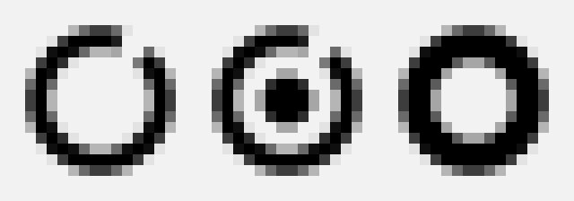

# EyeRecess（课间）· 护眼休息提醒

一个常驻托盘 / 菜单栏的小工具。它只干一件事：**按你真正盯着屏幕干活的时间**，在合适的时候提醒你闭眼、起身、看远处。

跨平台（macOS / Windows / Linux），基于 Electron，没有联网、没有账号、没有云同步。

---

## 一、它按什么节奏提醒

| 级别 | 触发条件 | 时长 | 你看到什么 | 能不能赖掉 |
| --- | --- | --- | --- | --- |
| **微休息** | 累计有效用眼 **10 分钟** | **20–30 秒** | 屏幕四条边泛起一圈呼吸光，不挡内容、不抢焦点 | 不用管它，但每 3 次里有 1 次会强制闭眼 |
| **短休息** | 累计用眼 **50 分钟** | **3–5 分钟** | 整屏遮罩：闭眼 90 秒 → 眨眼训练 30 秒 → 起身/远眺 80 秒 | 可延后 1 次（5 分钟） |
| **长休息** | 累计用眼 **2 小时** | **10–15 分钟** | 遮罩：闭眼 60 秒 → 离开屏幕，屏幕保持黑着 | 可延后 1 次（5 分钟） |

设置页里有四套预设，也可以逐项改数字：

- **标准（默认）** 10 分钟 / 50 分钟 / 2 小时
- **加强** 6 分钟 / 40 分钟 / 100 分钟（眼睛已经不舒服时用）
- **20-20-20** 每 20 分钟看 20 英尺外 20 秒（最保守、最不打扰的兼容档）
- **温和** 15 分钟 / 60 分钟 / 2 小时

这些数字不是拍脑袋定的，推导过程和引用的论文都在 [`docs/spec.md`](docs/spec.md)。一句话版本：

- 大家熟知的 20-20-20 法则**证据其实很弱**（2023 年一项 30 人实验里，休息间隔 5/10/20/40 分钟对眼疲劳、阅读速度、正确率都没有显著差异），而 2025 年的实验反而发现「每 10 分钟歇 20 秒」比 20-20-20 更能压住烧灼感和调节波动；
- 20 秒也不够：近距离用眼后的「调节滞后」需要 **20–70 秒**才回落，所以真闭眼至少给到 20–30 秒；
- 任何提醒软件的死穴都是**依从性**——经典实验里按时休息的比例只有约 50%，而且用户明显更喜欢 3 分钟的真休息而不是 30 秒的敷衍。所以这个 App 的重点不是「弹得更勤」，而是**弹得更少、但每次真能让你闭上眼**。

## 二、和别的护眼软件最大的不同：它算的是「有效用眼时间」

市面上多数软件按**墙钟**计时：45 分钟一到就弹窗，哪怕你中间去开了个会、摸鱼半小时。

EyeRecess 只在下面几条**同时成立**时才累计时间：

1. **最近 60 秒内有键鼠输入**——看视频、发呆、离开工位、旁边站着思考，统统不算用眼；
2. 不在休息中，也不在免打扰 / 暂停期间（这两段只计时、不打扰）。

另外：

- 你离开 **1 分钟**以上，微休息计时清零（回来重新算 10 分钟）；离开 **3 分钟**以上，视为已经休息过了，全部计时清零；
- 锁屏、睡眠、合盖：一律归零，醒来重新开始；
- **免打扰时段**（默认 22:00–08:00）或手动「暂停 30 分钟」期间只计时不打扰；免打扰结束后**不补发**刚才欠的提醒，只留一个 3 分钟缓冲；
- 检测到 **Zoom / Teams / 飞书 / 钉钉 / 腾讯会议 / Webex** 在运行，就自动降级成「只发光、不遮屏」——因为它没法真的判断你是不是在开会，宁可少打扰。
  （没有单独做「全屏应用不算用眼」的检测：跨平台拿不到可靠的系统接口，而且第 1 条已经覆盖了「看视频」这个主要场景。）

## 三、在 macOS 上跑起来

**最省事的方式：从 GitHub Releases 下 `.dmg`**（Apple Silicon 选 `arm64`，Intel 选 `x64`），拖进「应用程序」就行，不需要 Node.js。

这个包没有苹果签名，第一次打开会被 Gatekeeper 拦：

- 右键点 `EyeRecess.app` → **打开** → 再点「打开」；
- 或者「系统设置 → 隐私与安全性」里点「仍要打开」；
- 如果提示「已损坏，无法打开」，在终端跑一次 `xattr -cr /Applications/EyeRecess.app`（网上下载的文件带 quarantine 标记，Electron 的包没签名就会这样）。

之后它会常驻**屏幕右上角的菜单栏**（蓝色圆环），不会弹任何窗口。

默认还会在 Dock 里留一个图标（方便你第一次找到它）。想变成纯菜单栏应用：菜单栏图标 → 设置… → 系统 → 勾上「隐藏 Dock 图标」，图标立刻就没了。

### 直接从源码跑

需要先装 Node.js（≥ 18，推荐 20 以上）：<https://nodejs.org>

```bash
cd eyerecess
npm install     # 装 Electron，约 100 MB，第一次会比较久
npm start
```

启动后不会有窗口跳出来，**它待在屏幕右上角的菜单栏里**（一个蓝色的圆环图标）。点它就能看到菜单，点「设置…」打开设置页。

从源码跑的时候会有一个终端窗口、Dock 里也会有图标——这是 Electron 开发态的样子，功能完全一样。想要「纯菜单栏、没有任何窗口」的体验，用打包出来的 `.app`。

不想每次都敲命令的话，可以在设置页里打开「登录时自动启动」（打包版才生效；开发态下 Electron 会跳过这个设置，避免把 Electron 本身注册成登录项）。

### 试一下效果

```bash
npm run demo    # 演示模式：微休息 8 秒一次、短休息 20 秒一次、长休息 40 秒一次
```

一分钟内就能把三种休息、延后、强制闭眼全看一遍。

## 三·五、在 Windows 上跑起来

**最省事的方式：从 GitHub Releases 下 `EyeRecess Setup 0.1.0.exe`**（安装版，可以选安装目录）或者 `EyeRecess-0.1.0-win.zip`（免安装，解压出 `EyeRecess.exe` 双击就跑）。都不需要 Node.js。

这个包同样没有代码签名，第一次运行 SmartScreen 会提示「未知发布者」→ 点「更多信息」→「仍要运行」。

### 从源码跑（开发态）

**双击 `EyeRecess.vbs` 就行**——没有任何黑窗口，图标直接进系统托盘。

（`EyeRecess.vbs` 会在后台调 `scripts\launch.ps1`，自己不出现在任务栏；如果启动失败，它会弹一个对话框告诉你日志在哪。）

它比 `npm start` 多做的事，都不是可选项：

1. 先把 Electron 运行时复制一份到 `%LOCALAPPDATA%\EyeRecess\runtime` 再启动（原因见下面「为什么不能直接 npm start」）；
2. 把这次运行的完整信息写进 `logs\` 目录；
3. 盯着启动的头 25 秒：起来了就悄悄退出，没起来就弹框报错。

想要**看得见输出**的启动方式（排查用）：双击 `run-windows.cmd`（等于 `npm run win`），它会把退出码、错误输出、日志尾部全打印在那个黑窗口里。

从零开始的话：

```bat
cd eyerecess
npm install
EyeRecess.vbs
```

注意事项：

- 图标在**右下角系统托盘的折叠区**里（那个向上的小箭头 ^ 点开会看到蓝色圆环），不一定直接露在外面——可以把它拖到任务栏常显区。
- 用 `EyeRecess.vbs` 启动时**没有窗口**，程序在后台跑；要退出用托盘菜单里的「退出」。用 `run-windows.cmd` 启动时那个黑窗口得一直开着，关掉它程序也一起没了。
- 窗口一直开着的时候说明程序正常在跑；如果它退出了，窗口会打印**退出码**、错误输出、以及日志尾部。
- 所有日志都在项目里的 `logs\` 目录：`launch-*.log` 是每次启动的完整记录，`eyerecess.log` 是程序自己的日志（启动到哪一步、有没有崩），`chromium-last.log` 是底层 Chromium 的日志。托盘菜单里还有一项「打开日志文件夹」。
- 第一次启动会多花两三秒（要复制 150 MB 的运行时），之后就直接起来了。

### 为什么不能直接 `npm start`（在这台机器的工作区里）

`D:\Workspace\tools` 这个目录的 ACL 被加过沙箱规则，里面有一条 **对 Everyone 的继承拒绝项**。Chromium 内核启动早期会对自己所在目录做一次访问，被那条规则挡住，于是直接在原生层 `CHECK` 失败崩掉——**连 `electron.exe --version` 都会崩**，退出码 `-2147483645`，一行 JS 都来不及跑，所以也没有日志。

证据是同一个 exe（SHA256 完全一致）：
放到 `%LOCALAPPDATA%` 或 `D:\` 根目录 → `v45.0.0`，正常；
放在 `D:\Workspace\tools\` 下 → 必崩。

所以启动器把运行时搬到工作区外面去跑，App 源码留在原处（读文件不受影响）。这是本机环境的毛病，macOS 上没有这个问题，`npm start` 照常用的。

### 起不来的时候（窗口闪一下就没）

先双击 **`diagnose.cmd`**。它不改任何东西，只是收集信息，跑完会在项目目录生成 `诊断报告.txt`。
报告里有：系统环境、可疑环境变量、文件完整性、上一次的日志、**一个最小 Electron 窗口能不能开**、`--smoke` 的结果、正常启动 10 秒会不会活下来、以及 Windows 事件查看器里的崩溃记录。

看报告时的判断方法：

| 报告里的现象 | 说明 |
| --- | --- |
| 第 4 节没有日志文件 | 程序连第一行 JS 都没跑到，或者压根没被真正启动 |
| 第 5 节最小窗口也打不开 | **Electron 在这个系统上跑不起来**（缺 VC++ 运行库 / 杀毒软件拦截 / 显卡驱动），跟本项目代码无关 |
| 第 5 节能开、第 6 节 `--smoke` 报错 | 是我们程序的 bug，按报错信息修 |
| 第 7 节进程还活着 | 其实起来了，只是图标被折叠区藏住了，或者被别的窗口盖住 |
| 第 8 节有 `0xc0000005` | 原生层崩溃，把整段贴出来 |

日志都在项目里的 `logs\` 目录（`eyerecess.log` 是程序自己的日志，`launch-*.log` 是启动器的完整记录，`chromium-last.log` 是底层 Chromium 的）。没有 `EYERECESS_LOG_DIR` 时才会落到 `%APPDATA%\EyeRecess\logs\`。

常见退出码：

| 退出码 | 含义 | 怎么办 |
| --- | --- | --- |
| `0` | 自己退出了（不是崩溃） | 看日志最后几行，通常是单实例/配置问题 |
| `2` | 被当成普通 Node 脚本跑了 | 清掉 `ELECTRON_RUN_AS_NODE` 环境变量 |
| `3` | 已经有一个 EyeRecess 在跑 | 任务管理器 → 详细信息 → 结束所有 electron.exe |
| `-2147483645`（`0xC0000003`/`STATUS_BREAKPOINT`） | Chromium 原生初始化就崩了 | 运行时目录权限问题，确认它是从 `%LOCALAPPDATA%\EyeRecess\runtime` 跑的，别从工作区里直接跑 |
| `-1073741819`（`0xC0000005`） | 原生内存访问冲突 | 杀毒软件/显卡驱动，把整段报告贴出来 |

> **给改这些脚本的人**：`run-windows.cmd` / `diagnose.cmd` 必须是 **纯 ASCII + CRLF**（cmd.exe 按当前代码页逐字节解析批处理，混进中文或只有 LF 会让命令行被劈开，出现 `'ron.exe" .' 不是内部或外部命令` 这种莫名其妙的错误）；`scripts\*.ps1` 必须是 **UTF-8 with BOM + CRLF**（Windows PowerShell 5.1 才认得中文）。

### 不想装 Electron 也想先看界面长什么样

```bash
npm run preview
```

然后拿浏览器打开 `src/renderer/settings/_preview.html`（不需要 Node、不需要 Electron，双击就行）。
它喂的是假数据，只看排版和配色——真正的设置页是同一个 HTML/CSS/JS。

## 四、日常操作

**菜单栏图标**

- 单击：弹出菜单（连续用眼多久、下次微休息还有多久、立即休息、暂停、设置、退出）
- 图标三态（macOS 是模板图，跟随浅色/深色自动变色，靠形状区分）：

  

  空心环 = 正常，环 + 点心 = 快到时间了，实心环 = 正在休息。Windows / Linux 上是同一形状的彩色版本（灰 / 黄 / 绿）。

**快捷键**（可在设置里关掉）

| 快捷键 | 作用 |
| --- | --- |
| `Ctrl + Alt + B` | 立即开始一次短休息 |
| `Ctrl + Alt + P` | 暂停 / 恢复 30 分钟 |

**休息遮罩上**

- `Esc`：延后 5 分钟（每轮只有 1 次）
- `Enter` / 空格：提前结束（只在眨眼训练、起身这些阶段可用；闭眼阶段不给这个口子）

## 五、数据与隐私

全部存在你自己机器的用户目录里，不上传任何东西：

- macOS：`~/Library/Application Support/EyeRecess/config.json`、`stats.json`
- Windows：`%APPDATA%\EyeRecess\`
- Linux：`~/.config/EyeRecess/`

`stats.json` 保留最近 120 天，只记录每天的有效用眼秒数、各种休息的次数，不记录窗口标题、不记录你在干什么。设置页可以把今日统计清零，也可以直接删文件。

### 它要的权限：能不要的全不要了

这是个纯本地的小工具，所以做法是**把权限一格格关掉**，而不是去要更多：

| 项目 | 状态 | 说明 |
| --- | --- | --- |
| 联网 | **完全禁止** | 会话级拦截，只放行 `file:` / `data:` / `blob:` 这类本地资源，http/https/ws 一律取消。它一个字节都发不出去 |
| 摄像头 / 麦克风 / 定位 / 通知 / 剪贴板 | **全部拒绝** | 权限请求和权限检查两个回调都直接返回 false，系统层面不会弹授权框 |
| 渲染页面拿 Node | **拿不到** | `sandbox: true` + `contextIsolation: true` + `nodeIntegration: false`，页面只能通过 preload 暴露的少量函数跟主进程说话 |
| 页面跳转 / 开新窗口 / webview | **禁止** | 全局拦掉 `will-navigate`、`will-redirect`、`will-attach-webview`、`window.open` |
| 页面里的内联脚本 | **禁止** | 两页都上了严格 CSP：`script-src 'self'`，不许 eval、不许内联脚本、不许外部资源 |
| IPC 谁都能调 | **不是** | 每个 IPC 调用都校验「是不是我们自己的窗口 + 是不是我们自己的页面」，不通过就丢弃并记日志 |
| 打开外部链接 | **只允许 http/https** | 别的协议（`file:`、`smb:`、`javascript:`…）一律拒绝 |
| 键盘记录 | **不碰** | 只用系统提供的「鼠标键盘空闲了多少秒」这一个数字，不读按键内容 |
| 开机自启 | **默认关** | 打开后用系统自带的登录项接口，不写注册表 Run、不装服务、不要管理员权限 |

它唯一主动做的一件事是：每 15 秒看一下进程列表里有没有 `zoom` / `Teams` 这类会议软件在跑，用来在开会时把提醒降级成「只发光、不遮屏」。这个列表**只在内存里比一下，不记录、不上传**。

## 六、开发

```bash
npm test          # 全部测试（不需要图形界面）
npm run test:logic  # 纯逻辑：计时模型、配置、统计、免打扰
npm run test:boot   # 主进程联调：假 electron + 虚拟时钟，快进 4 小时跑完整节奏
npm run icons       # 重新生成托盘图标（不带任何图像库依赖，手写 PNG 编码）
```

目录结构：

```
src/main/      主进程：计时(tracker) 配置(config) 统计(stats) 免打扰(dnd) 遮罩窗口(overlay) 托盘图标(icons)
src/preload/   两个 preload：设置页 window.api、遮罩 window.ov
src/renderer/  两个界面：overlay（呼吸光 / 遮罩 / 眨眼训练）、settings（设置页）
scripts/       图标生成、逻辑测试、联调测试、Electron 二进制下载兜底
docs/spec.md   产品与研究依据（参数是怎么算出来的、引用了哪些论文）
```

`scripts/test-boot.js` 值得单独说一句：它用假的 `electron` 模块 + 虚拟时钟把主进程整个启动起来，快进 4 小时，断言 50 项——微休息是否在第 10 分钟出现、第 3 次是否强制闭眼、短休息延后 5 分钟后是否真的回来且不能再延、眨眼阶段能否提前结束、会议中是否只发光不遮屏、空闲 20 分钟是否完全不打扰、统计是否落盘。没有它，这个项目就只能靠肉眼验收。

## 七、打包与发布

已经配好 `electron-builder`，一条命令出包（**不能跨平台**，mac 包必须在 mac 上打）：

```bash
npm run dist:mac     # .dmg + .zip，arm64 与 x64
npm run dist:win     # NSIS 安装包 + 免安装 zip
npm run dist:linux   # AppImage
```

发版走 GitHub Actions：推一个 `v*` 的 tag，`.github/workflows/release.yml` 会在 macOS / Windows runner 上各自打包，汇总成 Release 草稿并附上 `SHA256SUMS.txt`。详细步骤（占位符怎么换、tag 怎么打、没签名会遇到什么）见 [docs/release.md](docs/release.md)。

## 八、已知限制

- **首次运行会被系统拦一下**：macOS 是 Gatekeeper（右键 → 打开，或 `xattr -cr`），Windows 是 SmartScreen（更多信息 → 仍要运行）。想彻底免掉要买签名证书，和个人项目不划算。
- 在这台 Windows 开发机上 **NSIS 安装包打不出来**（工作区 ACL 拒绝 makensis 建临时文件），本地只能打 zip；CI 的干净 runner 上两种都正常。原因见 [docs/release.md](docs/release.md) 第 5 节。
- 休息遮罩在全屏视频（如 QuickTime 全屏播放）之上能否盖住，取决于 macOS 版本和你是否开着「勿扰」；盖不住时会降级成菜单栏图标变色，不会静默失效。
- 早起/开会等场景无法自动判断，只能靠「检测到会议软件就降级」+ 手动暂停。
