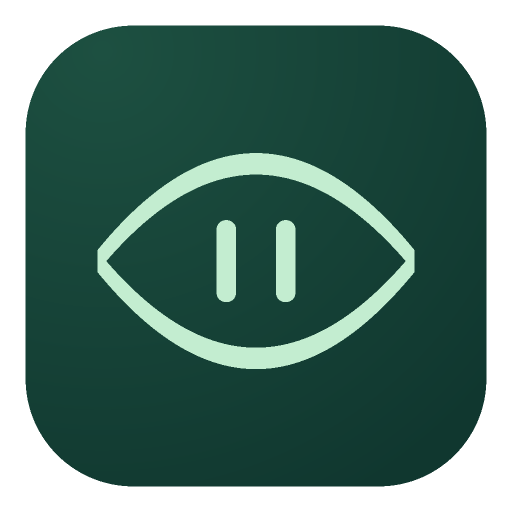
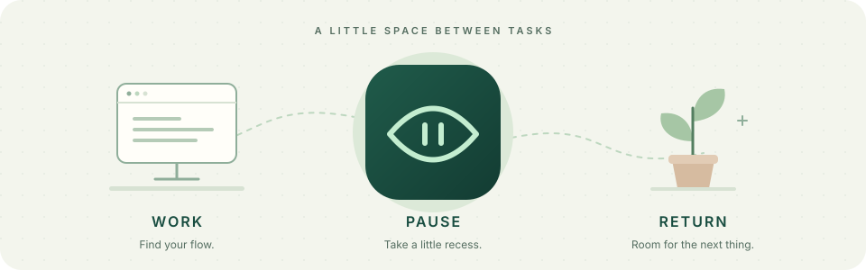
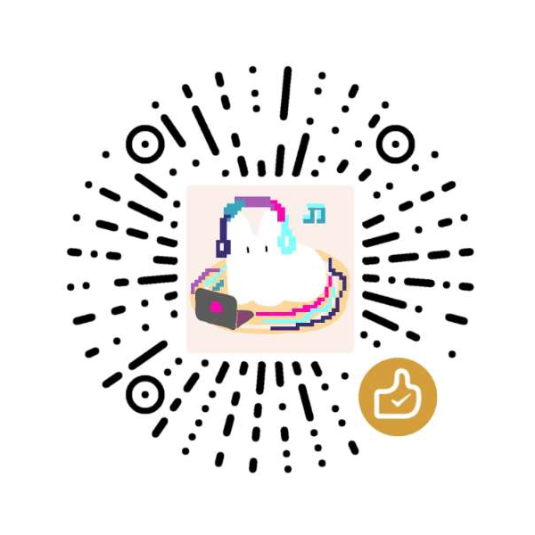
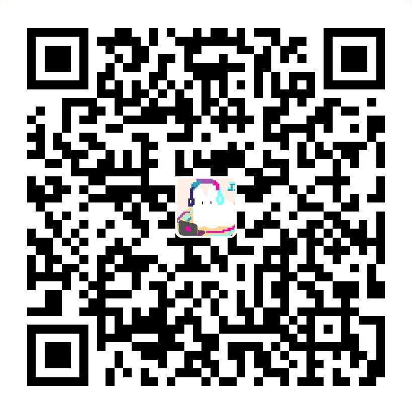
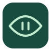

<p align="center">
  
</p>

<h1 align="center">EyeRecess · 课间</h1>

<p align="center">
  <strong>认真工作，也给眼睛一点课间。</strong><br />
  住在菜单栏和系统托盘里，提醒你适时离开屏幕。
</p>

<p align="center">
  <a href="https://github.com/ningninger/eyerecess/releases"><strong>下载应用</strong></a> ·
  <a href="#开始你的第一节课间">开始使用</a> ·
  <a href="README.md">English</a> ·
  <a href="docs/support.md">使用帮助</a>
</p>

<p align="center">
  无需账号 · 数据留在本机 · 按自己的节奏休息
</p>

<p align="center">
  
</p>

## 把休息，放进一天的节奏里

从推荐方案开始就好。EyeRecess 会根据估算的电脑活跃使用时间，安排三种不同分量的休息；想改一改时，再打开设置。

| 🌱 松一松 | 🌿 缓一缓 | 🌳 离开一会儿 |
| :--- | :--- | :--- |
| **微休息 · 每 10 分钟** | **短休息 · 每 50 分钟** | **长休息 · 每 2 小时** |
| 用屏幕边缘的柔和光晕提醒，间或安排一次闭眼。 | 跟着引导闭眼、眨眼，再起身活动一下。 | 暂时离开屏幕，走走、伸展，或接一杯水。 |

*以上是按估算活跃时间计算的默认间隔，每种提醒都可以单独调整或关闭。*

### 默认好用，也能很像你

- **先用起来。** 保留推荐方案，或选一个更合适的预设。
- **写一句自己的提醒。** 调整间隔、休息步骤和提示语；随时恢复推荐方案。
- **给专注留些余地。** 暂停提醒、设定勿扰时段，或在检测到会议软件运行时改用轻提醒。
- **安心读下去。** 在「更多设置 → 系统」开启阅读模式，阅读或看视频时，无键鼠操作也持续计时并正常提醒。
- **随时可以退出。** 每个引导阶段都有退出按钮，也可按 Esc 退出。微休息统一 20 秒，标准短休息缩短为 2 分钟。
- **把数据留在自己手里。** 设置和每日统计只保存在本机，无需账号或云同步。

### 0.1.2 带来了什么？

新增阅读模式，修复可能导致遮罩闪烁的重复刷新、计时延迟漏算等问题，并改进后台提醒资源的释放。活跃时间旁也会说明何时因空闲暂停计时。详细改动及验证范围见[更新记录](CHANGELOG.md)。

## 开始你的第一节课间

**[下载 EyeRecess →](https://github.com/ningninger/eyerecess/releases)**

| 平台 | 选择哪个文件 |
| :--- | :--- |
| **macOS** | Apple Silicon 选 `arm64` DMG；Intel 选 `x64` DMG |
| **Windows** | 安装版，或免安装的可执行文件 |
| **Linux** | 目前需要从源码运行，或自行构建 AppImage |

1. 启动应用，在菜单栏或系统托盘里找到眼睛图标。
2. 打开「设置」，保留推荐方案，或调整成自己的节奏。
3. 继续手头的事。想提前歇一歇，也可以手动开始休息。

关闭设置窗口后，EyeRecess 仍会运行；需要退出时，请使用菜单中的「退出」。

**已经安装了旧版？** 请先退出 EyeRecess，再下载新版并替换旧应用；macOS 用户请替换「应用程序」中的 EyeRecess。设置和每日统计会保留，打开设置后可在应用名称旁核对版本号。目前没有自动更新功能：拉取仓库或执行 `npm start`，都不会替换已经安装的 App。

> **普通用户不用安装开发依赖。** 安装版和免安装版已包含 Electron 运行环境，无需另装 Node.js、npm 或 Electron。GitHub 的「Source code」压缩包是源码，不能直接当作应用运行。

### 安装前了解一下

#### macOS 首次打开被阻止怎么办？

EyeRecess 是免费开源工具。维护者目前无力承担用于 Mac App Store 分发和 Developer ID 签名的 Apple Developer Program 年费，因此暂时通过 GitHub Releases 分发。当前 macOS 构建尚无 Developer ID 签名，也未经过 Apple 公证，首次打开时可能出现「无法验证开发者」或「Apple 无法检查其是否包含恶意软件」等提示。**用户无需支付这笔会员费。**

如果你从本仓库的 [Releases](https://github.com/ningninger/eyerecess/releases) 页面下载，并确认信任这份应用，可以按以下步骤打开：

1. 打开 DMG，将 **EyeRecess** 拖入「应用程序」，然后先尝试打开一次。
2. 如果系统阻止打开，前往 **「系统设置」→「隐私与安全性」**，向下滚动至靠近底部的 **「安全性」** 区域，在 EyeRecess 被阻止的提示旁点击 **「仍要打开」**。
3. 按提示验证身份，并在确认窗口中点击「打开」。不同 macOS 版本或设备管理策略下，按钮名称与可用性可能不同，详见 [Apple 官方说明](https://support.apple.com/zh-cn/102445)。

本项目代码公开，社区可以查看、检查、提出问题并参与改进，接受社区监督；这不代表每个版本都已通过独立安全审计。上述操作适用于开发者身份或公证验证提示；如果系统明确报告检测到恶意软件或应用会损坏电脑，请停止打开并反馈问题，不要绕过该警告。

#### 其他平台说明

当前 Windows 构建也尚未签名，首次运行可能出现系统提示。登录后自动启动仅适用于已打包的 macOS 和 Windows 应用。Linux Wayland 下的遮罩、窗口定位和全局快捷键可能受限，详见[平台兼容性](docs/compatibility.md)。

活跃时间与会议检测都是估算：被动阅读可能被视为空闲，会议软件开着也可能触发轻提醒。阅读或看视频时，可在 **「更多设置」→「系统」** 开启 **「阅读模式」**，无键鼠操作也持续计时并正常提醒；休息、锁屏和睡眠期间仍暂停累计，离开电脑时请锁屏。这个工具用于帮助建立休息习惯，不用于诊断或治疗。权限与本地存储边界见[安全说明](docs/security.md)。

## 想再了解一点？

<details>
<summary><strong>从源码运行</strong> — 需要 Node.js 22.12.0+ 和 npm</summary>

在项目根目录执行：

```bash
npm ci
npm start
```

首次安装需要联网，下载开发依赖和 Electron 运行程序；请等待安装脚本完成，不要跳过。安装成功后，应用可离线使用。从源码启动不会把应用安装到系统的「应用程序」目录。

已经装好 npm 包，但仍提示缺少 Electron？执行 `npm run setup:electron`，成功后再执行 `npm start`。如果提示 `fetch failed` 等下载错误，请查看[下载故障处理](docs/support.md#electron-download-failures)。

Windows 下，双击 `EyeRecess.vbs` 可无控制台启动；`npm run win` 可查看启动输出。

</details>

<details>
<summary><strong>参与开发与查阅文档</strong> — 工程内容统一使用英文</summary>

- [贡献规范与检查要求](CONTRIBUTING.md)
- [产品行为](docs/product.md)
- [架构与目录职责](docs/architecture.md)
- [开发流程](docs/development.md)
- [发布流程](docs/release.md)
- [更新记录](CHANGELOG.md)

提交改动前，请执行 `npm test` 和 `npm run check`。

</details>

## 支持一点「课间」

EyeRecess 免费开源。如果它对你有帮助，欢迎自愿赞助，用于支持项目维护与 Apple 开发者年费。是否赞助都不影响完整功能的使用。谢谢你为这个小工具添一份支持。

| 微信赞赏 | 支付宝 |
| :---: | :---: |
| <a href="docs/images/support-wechat.png"></a> | <a href="docs/images/support-alipay.png"></a> |

使用对应应用扫码，也可以点击图片查看原尺寸二维码。

---

<p align="center">
  <br />
  <sub>休息，也在计划之内。· <a href="LICENSE">MIT 许可</a></sub>
</p>
